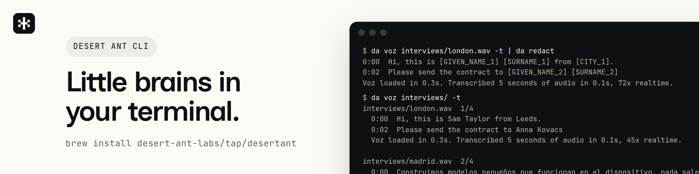
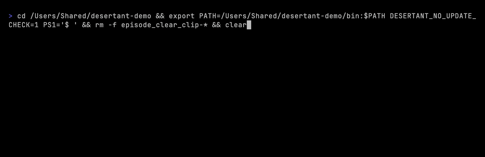
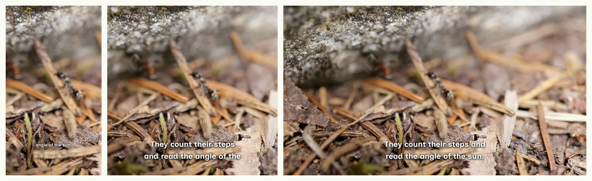

# Desert Ant CLI

  

Transcribe a recording and label who said what, cut the best moments into captioned clips, clean up the audio, find, rank, and crop photos, redact personal data from text, name the language of a line, flag nudity in a photo, or tag a topic, with [Desert Ant Labs](https://desertant.com) models running on your own machine. Run one model, or several in one command as a flow. Weights download once. Nothing leaves the device.



`da flow run podcast-clips episode.mp4` cleans up the sound of a 27s recording, transcribes it, picks the moment worth sharing, and writes it as a clip with the captions burned in. On an M3 Ultra, with the models already loaded once, the whole flow took 2.9s. The first run on a machine downloads the models and prepares them for the Neural Engine.



Captions follow the clip's shape: one short line at a time on a vertical clip, two lines on a square or wide one, in white over a soft shadow, in a font that comes with desertant, so a clip looks the same on macOS and Linux. The ant footage is by Samuel Koivisto, public domain, from [Wikimedia Commons](https://commons.wikimedia.org/wiki/File:Ffusca.webm).

Single models run from the terminal the same way:

```console
$ da voz talk.mp4 -t
0:00  We build small models that run on the device.
0:04  Nothing leaves the phone, and there is no cloud bill.
Transcribed 48 minutes of audio in 9.7s, 296x realtime.

$ da clips talk.mp4
 1  10:14 to 10:42  27s
    The one thing the meter can't sell you is inference that costs nothing.
    talk_clip-1.mp4
8 clips from 48 minutes in 41s.

$ da redact "Email Anna at anna@example.hu or call 555-0100"
Email [GIVEN_NAME_1] at [EMAIL_1] or call [PHONE_1]
```

`da` is short for `desertant`.

## Install

desertant runs on Apple silicon Macs with macOS 14 or later, and on Linux on x86_64 and arm64.

### Install script

```sh
curl -fsSL https://raw.githubusercontent.com/Desert-Ant-Labs/desert-ant-cli/main/install.sh | sh
```

Update with `da update`.

### Homebrew

```sh
brew install desert-ant-labs/tap/desertant
```

Update with `brew upgrade desertant`.

### mise

```sh
mise use -g "ubi:Desert-Ant-Labs/desert-ant-cli[extract_all=true]"
```

Update with `mise upgrade`.

### Linux requirements

desertant needs glibc 2.35 or later, such as Ubuntu 22.04, Debian 12, or Fedora 41, and libcurl. ffmpeg reads compressed audio, video, and images, and libheif reads HEIC photos:

```sh
sudo apt install ffmpeg libheif-examples libheif-plugin-libde265
```

## Flows

A flow runs several models on a file in one command. desertant comes with nine ready-made flows:

| Template | What it does |
| --- | --- |
| `podcast-clips` | Cleans up the sound, then cuts the moments worth sharing into clips with captions burned in. |
| `meeting-notes` | Names each speaker, replaces personal data with placeholders, and tags the main topic. |
| `transcript-and-captions` | Transcribes a recording into text, SRT, and WebVTT. |
| `who-said-what` | Transcribes a recording and names the speaker of each line. |
| `studio-sound` | Takes the noise and echo out of a recording and levels the voice. A video keeps its picture. |
| `filler-words` | Lists each uh, um, and hmm with its time. Runs on macOS. |
| `photo-keepers` | Copies the photos worth keeping into a Keepers folder, one of each near-duplicate. |
| `find-receipts` | Copies the receipts among your photos into a Receipts folder. |
| `redact-a-document` | Replaces the personal data in a text with placeholders and prints it. |

```sh
da flow run meeting-notes standup.m4a --set who.names="Anna,Ben"
da flow run podcast-clips episode.mp4 --set clips.count=3 --set clips.style=box
da flow run photo-keepers ~/Pictures/trip            # prints the plan
da flow run photo-keepers ~/Pictures/trip --apply    # copies the keepers
```

A flow saves its files beside the input, or in `--output-dir`, and never replaces a file. Steps that copy or rename your own files print a plan and change nothing until `--apply`.

To write your own flow, list the steps in YAML. An input left out of `uses` takes the nearest earlier output of the same name, so a straight chain needs no wiring:

```yaml
flow: 1
title: Clips and captions
steps:
  - type: audio
  - type: voz
  - type: clips
    with:
      captions: burn
      position: top
      count: 3
  - id: clipfiles
    type: folder
    uses:
      value: clips.files
    with:
      folder: Clips
  - type: captions
  - id: srt
    type: folder
    uses:
      value: captions.srt
    with:
      name: "{{name}}"
```

`da flow check clips.yml` shows how every input is wired, and `da flow new podcast-clips` copies a template out in full to edit. `da docs flows` has every step and rule.

## Captioned clips

`--captions burn` draws the words into each clip, for a feed where people watch without sound:

```sh
da clips talk.mp4 --captions burn
da clips talk.mp4 --captions burn --caption-style box --caption-position top --caption-color yellow
```

`--caption-lines` and `--caption-words` change how much text a caption holds, and `--caption-align`, `--caption-font`, `--caption-size`, and `--caption-weight` set the rest of the look. `--captions srt` writes an `.srt` beside each clip instead. Burning keeps the clip's size and frame rate at the highest quality unless you pass `--quality medium` or `low`. `da docs clips` has every option.

## Models

Each model has a page on [desertant.com](https://desertant.com/models/) with its numbers, its limits, and a live demo. `da info <model>` prints the same card.

- **[Voz](https://desertant.com/models/voz/)** `da voz talk.mp4`  
  Transcribe a recording, with a time on every word, in 25 languages.
- **[Who](https://desertant.com/models/who/)** `da who talk.mp4`  
  Label who said what in a recording: each speaker's turns and time.
- **[Clips](https://desertant.com/models/clips/)** `da clips talk.mp4`  
  Cut a podcast, interview, or meeting into short clips and highlights.
- **[Clear](https://desertant.com/models/clear/)** `da clear talk.mp4`  
  Studio sound: noise and room echo out, loudness leveled.
- **[Uhm](https://desertant.com/models/uhm/)** `da uhm talk.mp4`  
  Find every "uh", "um", and "hmm", with the exact span to cut.
- **[Ear](https://desertant.com/models/ear/)** `da ear talk.mp4`  
  Name the language being spoken, from 102.
- **[Redact](https://desertant.com/models/redact/)** `da redact "<text>"`  
  Replace names, emails, and phone numbers in a text with labels.
- **[Emo](https://desertant.com/models/emo/)** `da emo "<text>"`  
  Suggest emoji for a word or a sentence.
- **[Gist](https://desertant.com/models/gist/)** `da gist "<text>"`  
  Tag a post or article with topics, from a set of 36.
- **[Tongue](https://desertant.com/models/tongue/)** `da tongue "<text>"`  
  Name the language a short text is written in, from three words, in 84 languages.
- **[Moderator](https://desertant.com/models/moderator/)** `da moderator photo.jpg`  
  Flag nudity or sexual content before a photo is uploaded or shown.
- **[Eye](https://desertant.com/models/eye/)** `da eye photos/`  
  Find, rank, and crop photos, group near-duplicates, and pick a video's thumbnail.
- **[Title](https://desertant.com/models/title/)** `da title "<text>"`  
  Suggest a short factual title and a one- or two-sentence description for any text.

Redact, Emo, Gist, and Tongue are multilingual. Uhm and Title run on Apple silicon Macs. The rest also run on Linux, and `da models` lists what runs on your machine.

## Transcripts and captions

`da voz talk.mp4` prints the transcript, one sentence per line, and `-t` puts the time in front of each. Caption and text files are one flag each, written beside the input:

```sh
da voz talk.mp4 --srt          # talk.srt, captions
da voz talk.mp4 --vtt --txt    # talk.vtt and talk.txt
da voz talk.mp4 -o notes.vtt   # one file, the format from its extension
da voz talk.mp4 --format srt   # SRT on stdout, for a pipe
```

Captions are cut the way broadcasters cut them: two lines of 42 characters, no more than 7s on screen. `da docs voz` has the rest.

## Speakers

`da voz talk.mp4 --speakers` transcribes and labels each line with who said it, and `--names "Anna,Ben"` names the speakers in the order they first speak. The SRT, VTT, and text files carry the names. `da who talk.mp4` alone prints each speaker's time and turns, and `--format rttm` writes them for diarization tools. `da docs who` has the rest.

## Photos

`da eye` reads what a photo is, how it came out, and what is in it.

```console
$ da eye IMG_0056.jpeg
photo  keeper 0.27  aesthetic 0.76  cover 0.73  sharpness 0.89
sharp, cat, animal, keeper, pet, couch, furniture, himalayan
2 pets
```

On a folder, one flag asks one question about the photos together:

```sh
da eye trip/ --has beach --not blurry         # the paths of the matches
da eye trip/ --duplicates                     # near-duplicates, the keeper first
da eye trip/ --best                           # the one photo to keep
da eye trip/ --sort aesthetic --limit 5       # the five best looking
da eye trip/ --similar-to trip/IMG_3615.HEIC  # the most alike first
```

A filter prints one path per line, so the matches can go straight to another command. To move every screenshot off the desktop:

```sh
mkdir -p ~/Desktop/Screenshots
da eye ~/Desktop --has screenshot --strict | while IFS= read -r f; do mv "$f" ~/Desktop/Screenshots/; done
```

`--strict` counts a tag at a confidence of 0.9 instead of 0.5. Use it for anything that acts without asking. To set aside the extra shots of every burst and check them before deleting:

```sh
mkdir -p trip/extras
da eye trip/ --duplicates --json | jq -r '.groups[].others[]' | while IFS= read -r f; do mv "$f" trip/extras/; done
```

`--crop` writes Eye's best crop at an aspect, and on a video, `--thumbnail` writes the frame to use as its thumbnail:

```sh
da eye trip/ --sort cover --limit 5 --crop 1:1 --output-dir covers/
da eye launch.mp4 --thumbnail
```

Each run reads the photos again, at 0.3s a photo on an M4 Max. To ask many questions of a large folder, read it once into JSON and query the file:

```sh
da eye photos/ --recursive --all-tags --json > photos.json
jq -r '.[] | select(.kind == "receipt") | .input' photos.json
```

Eye is in closed beta, so set `HF_TOKEN` to a Hugging Face token with access to [desert-ant-labs/eye](https://huggingface.co/desert-ant-labs/eye). `da docs eye` lists the tags and the rest of the flags.

## Chain

Commands compose through their JSON. Transcribe once, then cut:

```sh
da voz talk.mp4 --json | da clips talk.mp4 --transcript -
```

`da schema --json` names which command's output feeds which, and `da docs pipelines` covers the rest. desertant never overwrites a file: a second run writes `talk_clear-2.mp4`, and `--force` is the only way around that.

## Folders

A file verb takes several files, or a folder, and loads the model once for all of them:

```sh
da moderator photos/ --json
da ear interviews/ --recursive
```

Under `--json` the result is an array with one entry per file. A file that fails is reported on stderr and the rest still run. The exit code is 1 at the end.

## Coding agents

One command writes a skill for every agent installed on your machine, in the current project: Claude Code and Pi get a skill file, Codex gets a section in `AGENTS.md`.

```sh
desertant setup
```

`desertant setup claude` does one agent, and `--global` writes where the agent looks for every project. Or paste this into the agent and let the agent do both steps:

```text
Install the Desert Ant CLI with: curl -fsSL https://raw.githubusercontent.com/Desert-Ant-Labs/desert-ant-cli/main/install.sh | sh
Then run `desertant setup` in this project.
```

Any other agent with a shell needs nothing more: every command returns JSON with `--json`, reads stdin, and exits 0, 1, or 64, and `da schema --json` describes each command and how they chain.

## Docs

`da docs` prints the docs offline. The same docs are in the repo, indexed by `llms.txt`: [using desertant from an agent](docs/agents.md), the [JSON contracts](docs/json.md), [files and the cache](docs/files.md), [speakers](docs/who.md), [photos and video](docs/eye.md), [clips](docs/clips.md), [flows](docs/flows.md), [pipelines](docs/pipelines.md), and [performance](docs/performance.md).

## License

MIT for the CLI. The models desertant runs are under the [Desert Ant Labs source-available license](https://license.desertant.com/1.0).
